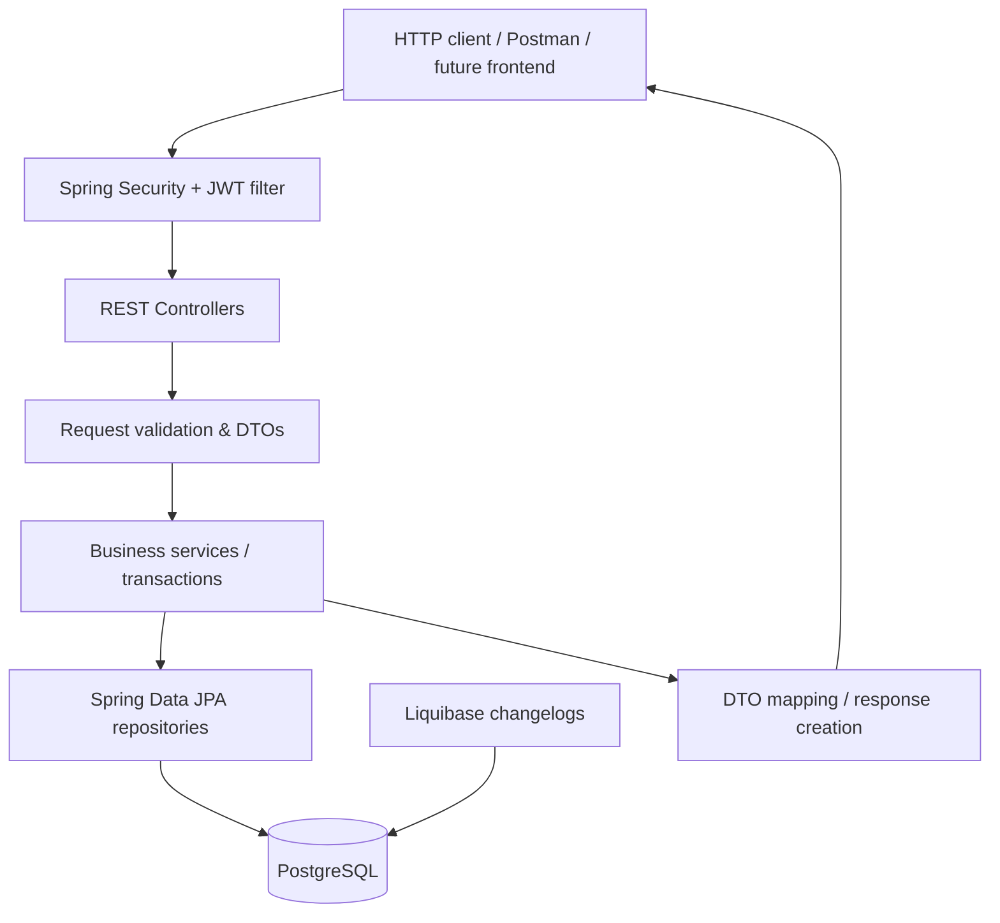

[Uploading README.md…]()
<div align="center">

# 🛒 E-Commerce Backend

**A modular REST API for a real-world e-commerce workflow, built with Java 17 and Spring Boot.**

From browsing products to checking out with promotions and leaving purchase-based reviews, this project focuses on **business rules, security, data consistency, and maintainable backend design**.


[Features](#-key-features) · [Architecture](#-architecture) · [Getting started](#-getting-started) · [API](#-api-overview) · [Business rules](#-business-rules) · [Tests](#-testing)

</div>

---

## ✨ Overview

This is a **backend-only** e-commerce application exposing versioned REST endpoints under `/api/v1`. The code is organized by business feature rather than as one large controller/service package. It includes JWT-based authentication, role-protected administration, catalog browsing, cart management, transactional checkout, promotions, and product reviews.

**Highlights**

- **Secure authentication:** registration, login, stateless JWT authentication, BCrypt password hashing, and role-based access rules.
- **Catalog management:** products and categories with admin-managed write operations; product search, filters, sorting, and pagination.
- **Shopping cart:** user-owned carts, add/update/remove operations, and quantity/stock validation.
- **Transactional checkout:** product stock checks, synchronized updates via database locking, order snapshots, promotion application, and cart clearing within a single transaction.
- **Promotions:** percentage/fixed discounts, optional coupon codes, automatic best-discount selection, date and usage limits, and product/category targeting.
- **Verified-order reviews:** 1–5 star ratings from users who have placed an eligible order containing the product; author/admin controls and aggregated product ratings.
- **API robustness:** request validation, centralized exception handling, predictable error responses, and database schema migrations via Liquibase.

> **Scope:** There is no integrated external payment gateway, refund workflow, or frontend in this repository. An order created by checkout is **not** proof of successful payment or delivery.

## 🧰 Tech stack

| Area | Technology |
| --- | --- |
| Language | Java 17 |
| Framework | Spring Boot 3.4.2, Spring Web |
| Security | Spring Security, JWT (JJWT), BCrypt |
| Persistence | Spring Data JPA, Hibernate, PostgreSQL |
| Migrations | Liquibase |
| Validation & mapping | Jakarta Bean Validation, MapStruct, Lombok |
| API documentation | Springdoc OpenAPI / Swagger UI |
| Build | Gradle Wrapper |
| Testing | JUnit / Spring Boot Test, Spock, Spring Security Test, Testcontainers |

## 🏗 Architecture

The application follows a **feature-based, layered monolith**:



**Core request flow:** `HTTP Request → Security Filter → Controller → Service → Repository → PostgreSQL → Response DTO`.

### Modules

```text
src/main/java/com/kahnhuseynov/ecommercebackend/
├── auth/            # Login and authentication responses
├── user/            # User registration and accounts
├── product/         # Product CRUD, search and filtering
├── category/        # Product categories
├── cart/            # Cart and cart items
├── order/           # Orders and checkout
├── promotion/       # Discounts, coupons and usage tracking
├── review/          # Product reviews and ratings
├── config/          # Spring Security configuration
└── core/            # Shared security, pagination, DTOs and exceptions
```

Each business module contains the relevant `controller`, `service`, `repository`, `entity`, and/or `dto` packages as needed.

## 🔄 Checkout flow

Checkout is more than creating an order record. Its key steps are implemented in `OrderServiceImpl` and `PromotionService`.

```mermaid
sequenceDiagram
    actor Buyer
    participant API as OrderController
    participant Order as OrderService
    participant Cart as CartRepository
    participant Product as ProductRepository
    participant Promo as PromotionService
    participant DB as PostgreSQL
    Buyer->>API: POST /api/v1/orders/checkout (JWT)
    API->>Order: checkout(userId, request)
    Order->>Cart: Lock and load user's cart
    Cart-->>Order: Cart + items
    loop Each item, sorted by product ID
        Order->>Product: Lock product + check active/stock
        Product-->>Order: Product
        Order->>Order: Deduct stock and snapshot item details
    end
    Order->>DB: Save order (PLACED)
    Order->>Promo: Apply eligible coupon/automatic promotion
    Promo->>DB: Validate and record discount usage
    Order->>Cart: Clear cart items
    Order-->>Buyer: 201 Created + order summary
    Note over Order,DB: All checkout changes are one transaction; failures roll back.
```

This design guards against common e-commerce problems such as overselling stock and consuming promotion usage for a failed checkout. Orders preserve item names/prices and discount information as **historical snapshots**.

## 🔐 Authentication and authorization

- **Public:** user registration, login, product/category reads, product review reads, and Swagger UI.
- **Authenticated:** shopping cart, checkout, order history, and review creation/editing (subject to ownership and eligibility rules).
- **Admin:** product/category writes and promotion management.
- **JWT:** clients send `Authorization: Bearer <accessToken>` for protected endpoints.
- **Stateless sessions:** the backend does not use server-side HTTP sessions for authentication.

Review modification and deletion also enforce per-review authorization in the service layer. See `SecurityConfig.java` and `ReviewServiceImpl.java` for the detailed rules.

## 🚀 Getting started

### Prerequisites

- **JDK 17**
- **PostgreSQL** running locally
- Git
- The included **Gradle Wrapper** (no global Gradle installation required)

### 1. Clone

```bash
git clone https://github.com/khanhuseynov/ecommerce_backend.git
cd ecommerce_backend
```

### 2. Create the database

In PostgreSQL, create a local database named `ecommerce_db`. By default, the application connects to `localhost:5432` as user `postgres`.

```sql
CREATE DATABASE ecommerce_db;
```

If your PostgreSQL host, port, database, or username differs, update the datasource properties in `src/main/resources/application.properties` for your environment.

### 3. Configure secrets

```bash
cp .env.example .env
```

Replace the placeholders in `.env` with your local PostgreSQL password and a newly generated JWT secret.

```bash
openssl rand -base64 32
```

The resulting base64 string can be used as `JWT_SECRET`. **Do not commit `.env` or real credentials.**

The application imports the local `.env` as optional Spring properties; launch it **from the repository root** so the relative file can be found. Alternatively, provide `DB_PASSWORD` and `JWT_SECRET` through your runtime environment.

### 4. Run

```bash
./gradlew bootRun
```

On Windows, use `gradlew.bat bootRun`.

Liquibase applies the configured migrations when the application starts and connects successfully to PostgreSQL.

### 5. Explore the API

- Swagger UI: `http://localhost:8080/swagger-ui/index.html`
- OpenAPI JSON: `http://localhost:8080/v3/api-docs`
- API base path: `http://localhost:8080/api/v1`

> The application uses the default Spring Boot HTTP port unless you configure another port.

## 📡 API overview

| Feature | Method | Endpoint | Access |
| --- | --- | --- | --- |
| Registration | `POST` | `/api/v1/users/register` | Public |
| Login | `POST` | `/api/v1/auth/login` | Public |
| Current user | `GET` | `/api/v1/auth/me` | Authenticated |
| Products | `GET` | `/api/v1/products`, `/api/v1/products/{id}` | Public |
| Manage products | `POST`, `PUT`, `DELETE` | `/api/v1/products[/{id}]` | Admin |
| Categories | `GET` | `/api/v1/categories`, `/api/v1/categories/{id}` | Public |
| Manage categories | `POST`, `PUT`, `DELETE` | `/api/v1/categories[/{id}]` | Admin |
| Cart | `GET`, `DELETE` | `/api/v1/cart` | Authenticated |
| Cart items | `POST`, `PUT`, `DELETE` | `/api/v1/cart/items[/{itemId}]` | Authenticated |
| Checkout | `POST` | `/api/v1/orders/checkout` | Authenticated |
| Orders | `GET` | `/api/v1/orders`, `/api/v1/orders/{orderId}` | Authenticated |
| Promotions | `GET`, `POST`, `PUT`, `DELETE` | `/api/v1/promotions[/{id}]` | Admin |
| Read reviews | `GET` | `/api/v1/products/{productId}/reviews[/{reviewId}]` | Public |
| Write reviews | `POST`, `PUT`, `DELETE` | `/api/v1/products/{productId}/reviews[/{reviewId}]` | Authenticated, with business rules |

**Product search example**

```http
GET /api/v1/products?search=phone&category_id=1&min_price=100&max_price=1500&page=0&size=10&sort=price,asc
```

### Example: register → login → order

**Register:**

```http
POST /api/v1/users/register
Content-Type: application/json

{
  "first_name": "Demo",
  "last_name": "Buyer",
  "email": "demo@example.com",
  "password": "example-password"
}
```

**Login:**

```http
POST /api/v1/auth/login
Content-Type: application/json

{
  "email": "demo@example.com",
  "password": "example-password"
}
```

Use the returned access token for authenticated requests:

```http
POST /api/v1/cart/items
Authorization: Bearer <accessToken>
Content-Type: application/json

{
  "product_id": 1,
  "quantity": 2
}
```

```http
POST /api/v1/orders/checkout
Authorization: Bearer <accessToken>
Content-Type: application/json

{
  "shipping_address": "Baku, Azerbaijan",
  "coupon_code": "SUMMER20"
}
```

The checkout example assumes the product is available and the coupon exists and is eligible. The `coupon_code` field is optional.

## 🧠 Business rules

### Cart and orders

- Users only operate on their own carts and orders.
- Inactive or insufficient-stock products cannot be checked out.
- Checkout acquires database locks for the cart and products, with products processed in ID order.
- Stock changes, order creation, promotion usage, and cart clearing share a transaction; failures roll back the transaction.
- Order items preserve product names, quantities, and prices at purchase time.

### Promotions and coupons

- Discounts can be **percentage-based** or **fixed amount**.
- Campaigns can have minimum spend, active dates, usage limits, per-user limits, and product/category scope.
- Without an explicit coupon, checkout can select the **eligible automatic promotion with the highest discount**.
- Explicit coupons do **not** stack with automatic promotions; invalid/ineligible codes reject checkout.
- Usage is counted only when checkout succeeds; deactivating a promotion retains usage history.
- Current checkout does not support payment processing, refunds, or restoring usage on cancellation.

See [Promotion documentation](docs/promotion.md).

### Reviews and ratings

- A user can review a product only if they have an order containing that product and the order is not cancelled.
- The same user may have only **one review per product**.
- Ratings are integers from **1 to 5**; comments are optional.
- The author can edit; the author or an admin can delete.
- Product responses expose **average rating** and **review count** computed from review data.
- An eligible order does not mean that payment or delivery was verified.

See [Review documentation](docs/review.md).

## 🗃 Database migrations

Liquibase runs migrations referenced by:

```text
src/main/resources/db/changelog/db.changelog-master.yaml
├── v1-user.yaml
├── v2-product.yaml
├── v3-category.yaml
├── v4-cart.yaml
├── v5-order.yaml
├── v6-promotion.sql
└── v7-review.sql
```

Schema versioning helps keep local and test environments consistent. The latest migrations add promotion usage/order discount snapshots and review constraints/indexes.

## 🧪 Testing

Run the test suite with:

```bash
./gradlew test
```

Run the unit/specification tests and login security test explicitly:

```bash
./gradlew test --tests '*Spec' --tests '*LoginSecurityTest'
```

Promotion and review integration tests use a **separate disposable PostgreSQL database**. They are skipped unless their corresponding environment variables are provided.

```bash
PROMOTION_TEST_DB_URL=jdbc:postgresql://localhost:55439/postgres \
PROMOTION_TEST_DB_USER=test_user \
PROMOTION_TEST_DB_PASSWORD=test_password \
./gradlew test --tests '*PromotionIntegrationTest'
```

```bash
REVIEW_TEST_DB_URL=jdbc:postgresql://localhost:55439/postgres \
REVIEW_TEST_DB_USER=test_user \
REVIEW_TEST_DB_PASSWORD=test_password \
./gradlew test --tests '*ReviewIntegrationTest'
```

**Important:** These integration tests create and modify database records. Never point them at a production or shared database. Adjust the sample URL/user/password to your disposable PostgreSQL instance.

## 📌 Design choices

| Choice | Why it matters |
| --- | --- |
| Feature-based packages | Keeps business responsibilities easy to discover and extend |
| Controller → Service → Repository | Separates HTTP, domain behavior, and persistence |
| DTOs + validation | Avoids exposing entities directly and rejects invalid client input |
| JWT + roles | Protects private actions and separates customer/admin capabilities |
| Transactional checkout + locks | Reduces overselling and inconsistent order/promotion state |
| Liquibase migrations | Makes database changes explicit and repeatable |
| Database constraints | Reinforces application rules such as review uniqueness |
| Tests | Exercises authorization, persistence, and business-rule edge cases |

## 🔭 Potential next steps

These are **possible improvements**, not features currently implemented:

- Integrate a payment provider and handle asynchronous payment events.
- Define order cancellation/refund policies and promotion usage restoration.
- Add CI checks and automated deployment.
- Add observability (structured logs, health metrics, tracing).
- Add a separate frontend client.

---

<div align="center">

**Built by [khanhuseynov](https://github.com/khanhuseynov)**  
[Repository](https://github.com/khanhuseynov/ecommerce_backend) · [Promotion details](docs/promotion.md) · [Review details](docs/review.md)

</div>
